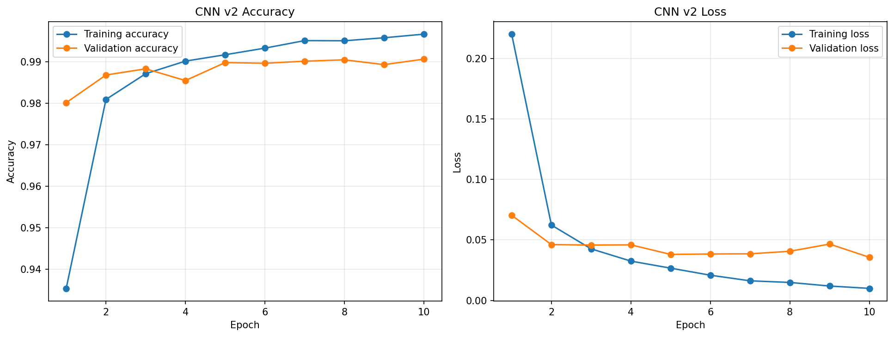
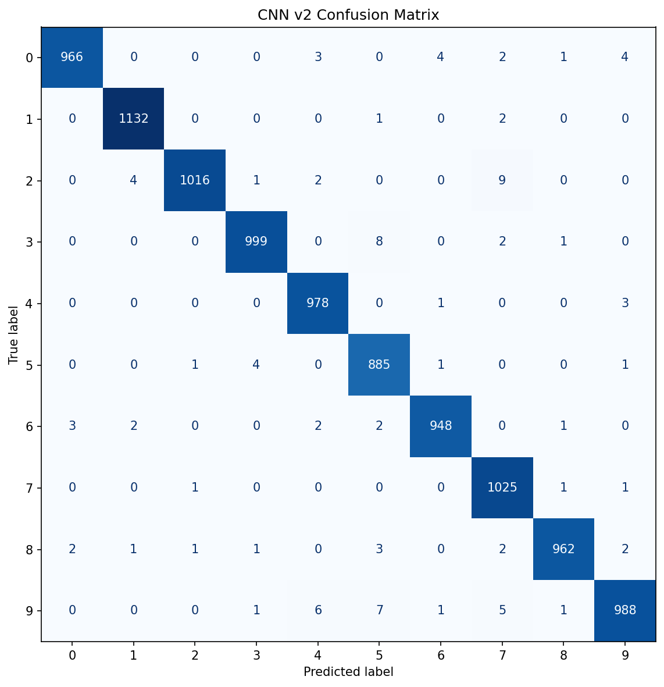
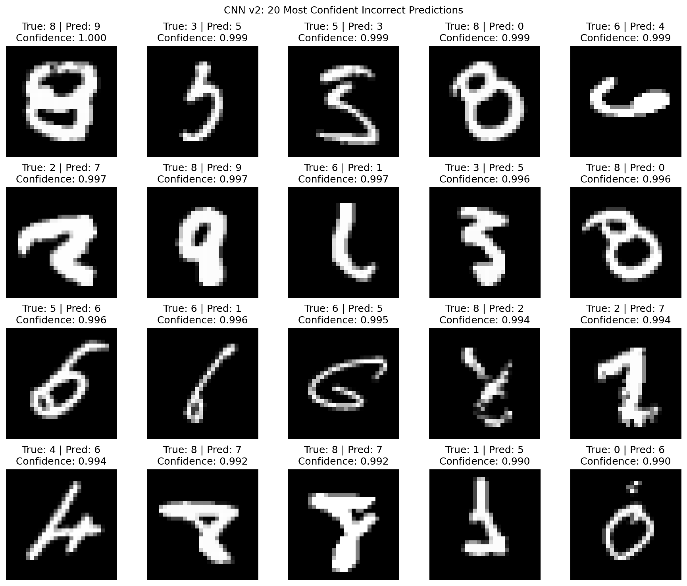

# Handwritten Digit Recognition using CNN

A machine learning project developed as part of the AgenticX Machine Learning Internship. The project classifies handwritten digits (0–9) from the MNIST dataset and compares a traditional machine learning baseline with two Convolutional Neural Network (CNN) architectures.

## Project Overview

The objective is to build, evaluate, and compare models for handwritten digit recognition using a consistent test dataset.

### Models
1. **Logistic Regression:** Non-neural baseline using flattened 28×28 images.
2. **CNN v1:** A simple CNN with one convolutional layer.
3. **CNN v2:** An improved CNN with two convolutional layers.

## Dataset

- Dataset: MNIST handwritten digits
- Training images: 60,000
- Test images: 10,000
- Image dimensions: 28 × 28 pixels
- Number of classes: 10 (digits 0–9)
- Preprocessing: Images normalized to the range [0, 1].
- CNN input shape: 28 × 28 × 1

## Model Architectures

### Logistic Regression
Images are flattened into 784 features and classified using scikit-learn Logistic Regression.

### CNN v1
- Conv2D: 32 filters, 3 × 3, ReLU
- MaxPooling2D: 2 × 2
- Flatten
- Dense: 128 units, ReLU
- Dense: 10 units, Softmax

### CNN v2
- Conv2D: 32 filters, 3 × 3, ReLU
- MaxPooling2D: 2 × 2
- Conv2D: 64 filters, 3 × 3, ReLU
- MaxPooling2D: 2 × 2
- Flatten
- Dense: 128 units, ReLU
- Dense: 10 units, Softmax

Both CNNs use the Adam optimizer and sparse categorical cross-entropy loss. Training used a batch size of 128, 10 epochs, and a 10% validation split.

## Results

All three models were evaluated on the same 10,000 MNIST test images.

| Model | Test Accuracy | Incorrect Predictions |
|---|---:|---:|
| Logistic Regression | 92.59% | 741 |
| CNN v1 | 98.08% | 192 |
| CNN v2 | **98.99%** | **101** |

CNN v2 improved test accuracy by 0.91 percentage points over CNN v1 and reduced the number of errors from 192 to 101.

### Inference Timing

| Model | Average Measured Inference Time |
|---|---:|
| Logistic Regression | 0.0157 ms/image |
| CNN v1 | 0.1066 ms/image |
| CNN v2 | 0.1311 ms/image |

These are measurements from the project runtime, not a hardware-independent benchmark. Runtime and framework overhead can affect comparisons.

## Evaluation and Error Analysis

Evaluation includes:
- Test accuracy and loss
- Per-class precision, recall, and F1-score
- Confusion matrices
- Training and validation accuracy/loss curves
- Analysis of the 20 most confidently incorrect predictions

### CNN v2 Training Curves


### CNN v2 Confusion Matrix


### CNN v2 Error Analysis


The CNN v2 classification report shows a weighted F1-score of approximately 99.0%. The most confidently incorrect predictions also demonstrate that high prediction confidence does not guarantee correctness.

## Project Structure

```text

AgenticX-Handwritten-Character-Recognition/
├── 01_AgenticX_Handwritten_Character_Recognition.ipynb
├── 02_AgenticX_Hand_Written_Project.ipynb
├── README.md
├── requirements.txt
├── models/
│   ├── logistic_regression_baseline.joblib
│   ├── cnn_v1.keras
│   └── cnn_v2.keras
├── plots/
│   ├── cnn_v1_confusion_matrix.png
│   ├── cnn_v1_training_curves.png
│   ├── cnn_v1_worst_20_predictions.png
│   ├── cnn_v2_confusion_matrix.png
│   ├── cnn_v2_training_curves.png
│   ├── cnn_v2_worst_20_predictions.png
│   └── logistic_regression_confusion_matrix.png
└── results/
    ├── baseline_metrics.npz
    ├── cnn_v1_history.npz
    ├── cnn_v1_test_metrics.npz
    ├── cnn_v1_worst_20_errors.csv
    ├── cnn_v2_classification_report.txt
    ├── cnn_v2_history.npz
    ├── cnn_v2_test_metrics.npz
    ├── cnn_v2_worst_20_errors.csv
    ├── final_model_comparison.csv
    └── model_comparison.csv
```

Generated datasets, model files, checkpoints, and prediction arrays are stored locally or in Google Drive and do not all need to be committed to GitHub.

## 📓 Notebook Guide and Execution Order

This repository contains two Jupyter notebooks that document the development, training, evaluation, and improvement of the handwritten digit recognition models.

### Notebook 1 — Initial Setup and CNN v1

**File:** `01_AgenticX_Handwritten_Character_Recognition.ipynb`

This notebook covers the initial development workflow:

- Google Drive connection and project setup.
- MNIST dataset loading and preprocessing.
- Logistic Regression baseline model training and evaluation.
- CNN v1 model architecture and training.
- Saving model checkpoints, training history, and the trained model.

**Purpose:** Establish the baseline and train the first CNN model.

### Notebook 2 — CNN v1 Evaluation, CNN v2 and Final Analysis

**File:** `02_AgenticX_Hand_Written_Project.ipynb`

This notebook continues the experiments and focuses on improving and evaluating the models:

- Evaluation of the trained CNN v1 model.
- Development and training of the improved CNN v2 model.
- Comparison of Logistic Regression, CNN v1, and CNN v2.
- Confusion matrices and training/validation curves.
- Classification reports and per-class performance analysis.
- Analysis of the 20 most confidently incorrect predictions.
- Inference-time measurement and final result comparisons.

**Purpose:** Improve model performance, analyze classification errors, and compare all three models.

### How to Run the Notebooks

**Recommended execution order:** Notebook 1 → Notebook 2.

1. Open the desired `.ipynb` file from this repository.
2. To execute it online, open [Google Colab](https://colab.research.google.com/) and upload the downloaded notebook, or use the available **Open in Colab** option.
3. Connect Google Drive if prompted and verify that the project folders and file paths match your environment.
4. For a fresh run, execute Notebook 1 first so that the dataset, baseline model, CNN v1 model, and required intermediate artifacts are created.
5. Next, open Notebook 2 and execute its cells in order to evaluate CNN v1, train CNN v2, and generate the final comparisons and error-analysis results.

**Continuing existing work:** If you have already completed the earlier steps and the required datasets, trained models, and intermediate results are available in Google Drive, you may be able to continue from Notebook 2 without retraining the previous models.

**Important notes:**
- The notebooks use Google Drive paths that may need to be updated for another environment.
- Some cells depend on artifacts generated by earlier cells or stored in Google Drive. If a required file is missing, regenerate it using the relevant earlier step.
- The notebooks are provided for transparency and reproducibility. You can inspect the code and existing results without rerunning the entire training process.
- Training time and inference speed may vary depending on the hardware and software environment.

## Installation

Use Python 3.11 or another Python version compatible with the installed TensorFlow release.

```bash
pip install -r requirements.txt
```

## Reproducing the Project

1. Obtain the MNIST dataset through TensorFlow/Keras.
2. Normalize the images and prepare CNN and flattened input formats.
3. Train the Logistic Regression baseline.
4. Train CNN v1 and save its training history and model.
5. Train CNN v2 using the additional convolutional layer.
6. Evaluate each model on the same held-out test set.
7. Generate the classification reports, confusion matrices, and error-analysis plots.

The saved models and results in this repository are artifacts from the completed experiment. Include the actual Colab notebook or training scripts in the repository if you want others to reproduce the full workflow directly.

## Technologies Used

- Python
- TensorFlow / Keras
- scikit-learn
- NumPy
- pandas
- Matplotlib
- Google Colab
- Google Drive

## Future Improvements

- Test data augmentation to improve robustness.
- Experiment with dropout or batch normalization.
- Compare inference latency under a controlled environment.
- Build a small interface for predicting digits from user-drawn images.
- Evaluate performance on handwritten samples outside MNIST.

## Acknowledgements

Developed as part of the AgenticX Machine Learning Internship.

Dataset: MNIST handwritten digits.
